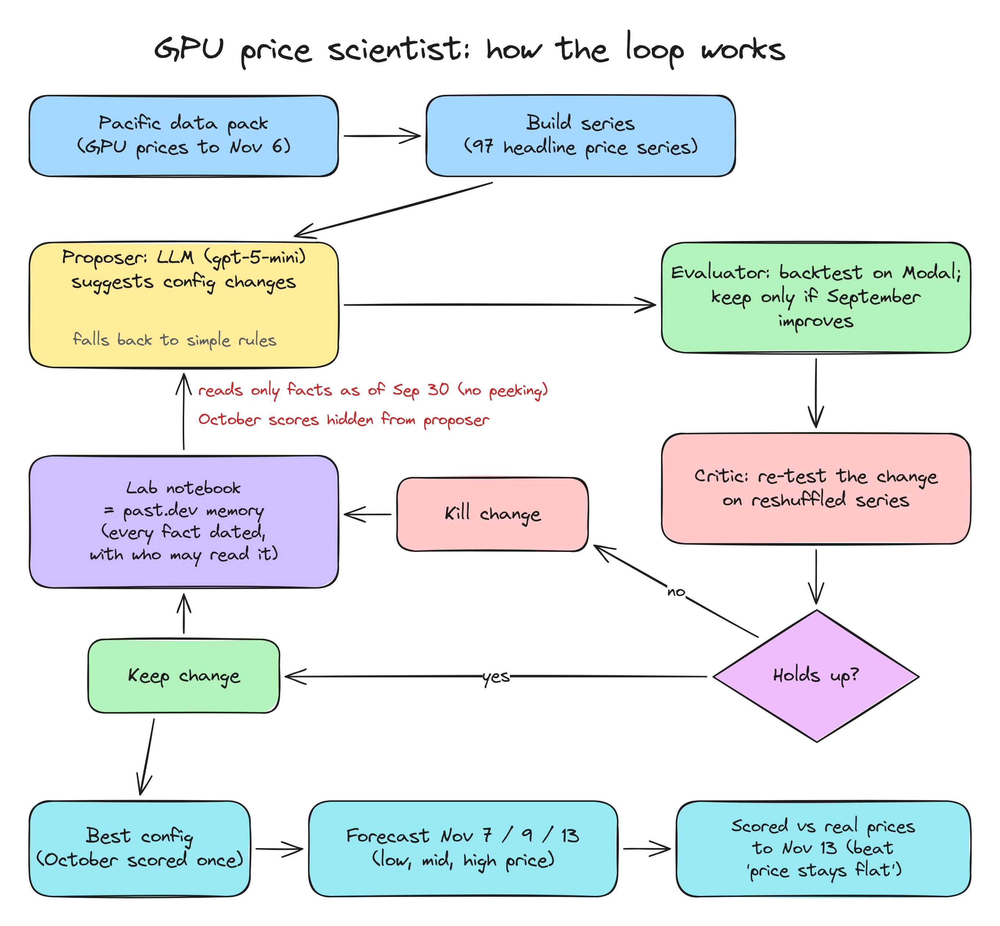

# gpu-scientist

An AI scientist that forecasts GPU rental prices for the Pacific track at the SF AI Research Hackathon (14–15 Nov 2026). Three agents share an experiment ledger on past.dev and run their backtests on Modal.



## Idea
Posted GPU rental prices move in steps, so on most days tomorrow's price equals today's. The middle forecast is the last price. The low and high come from how often each kind of seller reprices, and by how much. A team of agents improves the forecaster one change at a time. A change counts only if it wins on September origins; October is scored once, at the end.

## Results
The submission uses the agent loop's pick. On the 37 series that are scored, its October skill is +0.149 vs +0.122 for the starter: a gain of +0.027, 95% interval +0.008 to +0.055. It also beats our earlier hand pick (+0.134) by +0.015 (+0.004 to +0.027). Its 10–90 band holds the truth 71% of the time, against 62% for the starter and a target of 80%. We picked it after seeing October, so that October number is optimistic. Details, the agent loop's rounds and what lives in past.dev are in [`loop/README.md`](loop/README.md).

In v8, three AI researchers rewrote the forecaster's code under an hourly director: 144 experiments, 57 kept, September skill from +0.185 to +0.333. On held-out October the v8 pick scored +0.069 against +0.149 for v7, a gap of −0.080 (95% interval −0.130 to −0.023). It was fitted to the months it tuned on, so v7 stays submitted. The pick rule was written down before October was opened, and October was run once.

Rebuild the results and the submission in one command:

```bash
cd loop && uv sync --group pack && ./reproduce.sh <unzipped gpu-price-pack-v0.1.1-handover dir>
```

## Memory on past.dev
- *Three identities.* The proposer, evaluator and critic each read and write as their own past.dev identity.
- *Public ledger, private October.* Every hypothesis, keep-or-kill decision and critic verdict is public. October scores go to a private audience whose only member is the critic. In run `scored37-e` the proposer got 0 of the 32 private facts.
- *Point-in-time reads.* Each fact is dated by the market day it describes, and each read sends the reader's forecast date. A read as of 30 September sees nothing later.
- *Enforced on the server.* past.dev applies the audience and date rules itself; `loop/tests/test_pastdev_live.py` checks this against the live API, and the client filters again.
- *v8.* Every researcher experiment is also written to past.dev (scope `research-v8`, as that researcher's identity). The researchers work from a local shared notebook and read past.dev only with `--past`. In v8, past.dev is a mirror and audit trail, not the working memory.
- *Caveats.* All agents share one project key, so an identity is a label, not a credential. We ran no memory ablation, so we have no number for how much memory adds.

Details and the full counts are in [`loop/README.md`](loop/README.md#pastdev-challenge).

## Data
Pacific gpu-price-pack v0.1.1-handover (CC BY 4.0, data cutoff 6 Nov 2026). Not committed here; see `data/README.md` for how to fetch and verify it.
