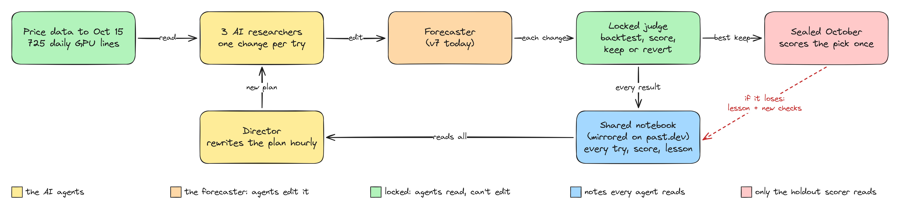

# gpu-scientist

Team: Step Function

An AI scientist that forecasts GPU rental prices for the Pacific track at the SF AI Research Hackathon (14–15 Nov 2026). Three agents share an experiment ledger on past.dev and run their backtests on Modal.



The v8 loop: 3 AI researchers, a locked judge, a director, and the shared notebook (mirrored on past.dev)

The v7 loop that made the submission: [`docs/loop.png`](docs/loop.png)

Data flow, and who can read what: [`docs/data-flow-v2.png`](docs/data-flow-v2.png) (full detail: [`docs/data-flow.png`](docs/data-flow.png)).

## Presentation

The final presentation deck is [`docs/step-function-deck-v5.pdf`](docs/step-function-deck-v5.pdf).

Demo video (2:23): https://youtu.be/SzSlT4WRufI

## Idea
Posted GPU rental prices move in steps, so on most days tomorrow's price equals today's. The middle forecast is the last price. The low and high come from how often each kind of seller reprices, and by how much. A team of agents improves the forecaster one change at a time. A change counts only if it wins on September origins; October is scored once, at the end.

## Results
The submission uses the agent loop's pick. On the 37 series that are scored, its October skill is +0.149 vs +0.122 for the starter: a gain of +0.027, 95% interval +0.008 to +0.055. It also beats our earlier hand pick (+0.134) by +0.015 (+0.004 to +0.027). Its 10–90 band holds the truth 71% of the time, against 62% for the starter and a target of 80%. We picked it after seeing October, so that October number is optimistic. Details, the agent loop's rounds and what lives in past.dev are in [`loop/README.md`](loop/README.md).

In v8, three AI researchers rewrote the forecaster's code under an hourly director: 144 experiments, 57 kept, September skill from +0.185 to +0.333. On held-out October the v8 pick scored +0.069 against +0.149 for v7, a gap of −0.080 (95% interval −0.130 to −0.023). It was fitted to the months it tuned on, so v7 stays submitted. The pick rule was written down before October was opened, and October was run once. Healing is now automatic. Today's v8.1 round was started by a human; from 23d89ba the trigger is in the loop. On a replay of the v8 failure, a fresh director proposed 3 checks: all reject the v8 pick, pass v7 and reject none of 14 earlier keeps, for $0.78. Logs: [`loop/research/heal/round_6-dry/`](loop/research/heal/round_6-dry/).

v7 is the submission; [`loop/challenger_v81_2026-11-06.csv`](loop/challenger_v81_2026-11-06.csv) is the v8.1 pick as a labelled challenger, not submitted. On held-out Oct 16–30 it scored +0.123 against v7's +0.109, a gap of +0.014 (95% interval −0.027 to +0.053): neither shown worse nor shown better. Details: [`loop/research/v81-record/HOLDOUT.md`](loop/research/v81-record/HOLDOUT.md).

Rebuild the results and the submission in one command:

```bash
cd loop && uv sync --group pack && ./reproduce.sh <unzipped gpu-price-pack-v0.1.1-handover dir>
```

## past.dev challenge
Short version below. The full one, with every count and the API calls, is in [`loop/README.md`](loop/README.md#pastdev-challenge). Demo: `loop/demo_read.sh`.

### Agents
Each agent reads and writes as its own past.dev identity.

| Agent | Identity | Audiences | Writes | Reads |
| --- | --- | --- | --- | --- |
| proposer | `pacific-proposer` | public only | hypotheses | as of 30 Sep: the evaluator's decisions and the critic's verdicts, to skip tried ideas and rank params |
| evaluator | `pacific-evaluator` | writes to `holdout-scores`, cannot read it | keep or kill with Jul–Sep numbers (public); October scores (private) | nothing |
| critic | `pacific-critic` | `holdout-scores` (its only member) | verdicts (public); its resample numbers (private) | as of 31 Oct: the evaluator's decisions and private scores, to pick what to re-check |
| v8 researchers | `pacsci1`, `pacsci2`, `pacsci3` | public only | one fact per experiment, scope `research-v8` | past.dev only when run with `--past` |

In v8 the researchers work from a local shared notebook. past.dev is their mirror and audit trail, not their working memory.

### Layers
- *Working:* each agent's task, in its prompt. Not shared.
- *Public ledger:* hypotheses, decisions and verdicts. Why: the proposer needs the history so it doesn't repeat ideas.
- *Private October:* the audience `holdout-scores`. Why: the proposer must never tune on October, and the critic needs it to judge.
- *Time:* each fact is dated by the market day it describes, and each read sends the reader's forecast date. Why: a read as of 30 September sees nothing later.
- *Run:* a scope tags every fact. Why: an idea judged in another run is not evidence here.

past.dev enforces the audience and the date cut on the server, and the client filters both again. `loop/tests/test_pastdev_live.py` checks the server side against the live API.

### Results
- Run `scored37-e` wrote 110 facts: 78 public and 32 private.
- The proposer read 89 evaluator facts and 68 critic facts, and used them to skip tried ideas. It got 0 of the 32 private facts.
- 24 ideas, with no repeats.
- In v8, at least 87 of the 294 researcher notebook rows read back from past.dev, and no write failed. 87 is a floor: the read-back uses search, which can't list a scope.

### Caveats
- *One shared key.* All agents use one project key, so an identity is a label, not a credential.
- *No memory ablation.* We never ran the loop without memory, so we have no number for what memory adds.
- *Recall can't list or filter by run.* In run `scored37-d` the proposer missed one of its ideas, reused its id and overwrote a kept idea's fact. We stopped that run and fixed it.
- *Only October is private.* There are no per-agent private notes.
- *Small scale.* A run writes tens of facts (v8: at least 87).
- *v8 tests past.dev only as a mirror.* Its working memory was a local notebook.

## Data
Pacific gpu-price-pack v0.1.1-handover (CC BY 4.0, data cutoff 6 Nov 2026). Not committed here; see `data/README.md` for how to fetch and verify it.

## Targets
Each target is one series from the pack's catalog: one collector, one instrument class, one GPU model and one pricing tier. Its value is the median USD per GPU-hour over that collector's offers on the UTC day, all regions pooled, with no commitment term (the catalog's benchmark contract). We forecast all 725 series. Sunday scores the 37 that the catalog marks headline:

| Collector | Instrument | Tier | Scored series |
| --- | --- | --- | --- |
| afhubbard | hyperscaler spot price | spot | 4 |
| fastgpu | hyperscaler spot price | spot | 2 |
| fastgpu | neocloud rate card | on-demand | 11 |
| fastgpu | neocloud spot price | spot | 7 |
| gpurentalprices | neocloud rate card | on-demand | 12 |
| gpurentalprices | marketplace ask | spot | 1 |

We never chain instruments. Each forecast starts from its own series' last value. The band may borrow past price changes from other series of the same instrument class, from any collector, but never from another class. No list prices are in the scored set, and no index, resale or launch price is used as a target or an input.
