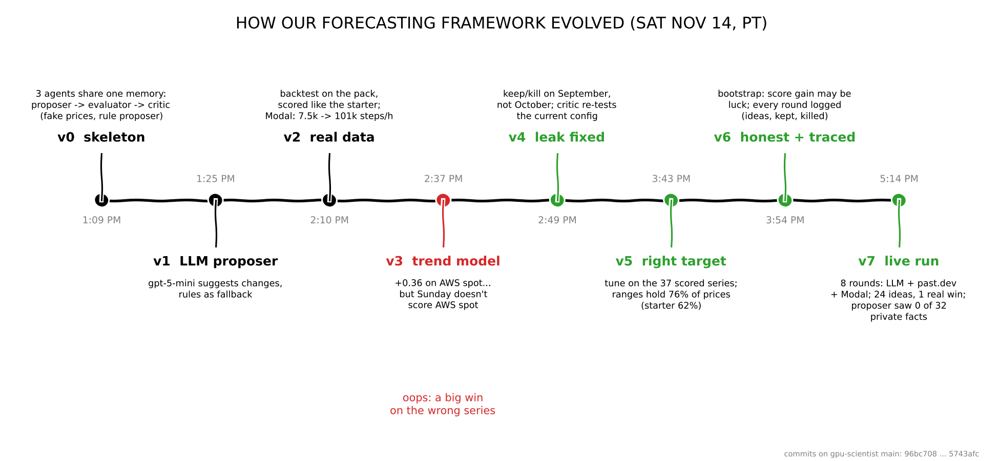
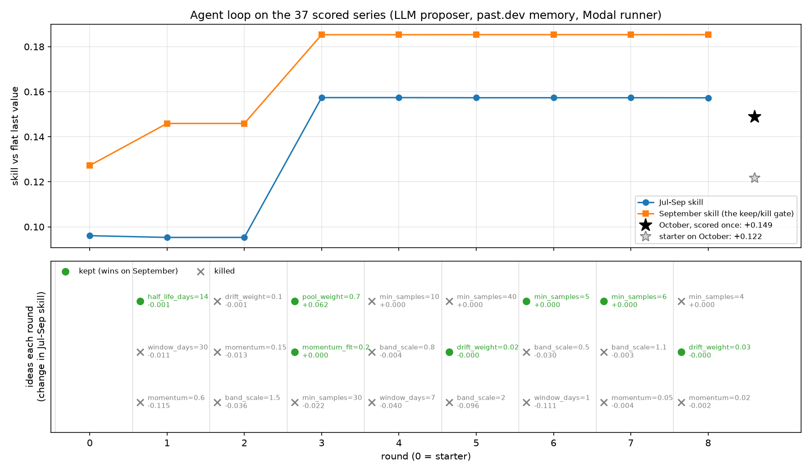

# Findings

TODO (owner): one-sentence headline, written after Sunday's score.

## Question

Can a team of agents, changing a forecaster one setting at a time, beat the last posted price on GPU rental series 1, 3 and 7 days ahead, without ever seeing the month it is judged on?

Posted rental prices move in steps. On most days tomorrow's price equals today's, so the last price is a hard baseline to beat. Any gain has to come from the band around it: how likely a seller is to reprice, and by how much.

## Method

The forecaster's middle quantile is the last posted price. Its 0.1 and 0.9 quantiles come from how often and how far each kind of seller has repriced before. The starter uses each series' own history only.

Three agents improve it through one shared memory on past.dev:

- a proposer reads past decisions and suggests one-setting changes;
- an evaluator backtests each batch in parallel on Modal and keeps a change only if it raises September skill without lowering July to September skill;
- a critic re-scores kept changes on resampled series mixes and rolls back the ones that don't hold.

October scores sit behind a read boundary, and no decision uses them. Each fact in the memory has a date. The proposer reads as of September 30, and the past.dev server applies that cut. October numbers carry a critic-only audience, which the server leaves out of proposer and evaluator reads. A live test against the server checks both (tests/test_pastdev_live.py). The client filters again on top, and on the local JSONL backend the client does all the filtering.

All three agents share one past.dev project key and name themselves in each request. So the boundary keeps honest code away from October numbers. It would not stop an agent that lies about its identity.

The submitted configuration came out of the agent loop's last run (v7 on the timeline below). It differs from the starter in five settings, and two of them do the work. It borrows repricing behavior from the other series of the same class in the pack, which together get 0.7 times the weight of the series' own history. And it weights recent repricing more (14-day half-life). The other three (drift weight 0.03, minimum samples 6, momentum fit 0.2) each moved skill by less than 0.001 when replayed alone. Configs: loop/submit_config.json. Rebuild: loop/reproduce.sh.

We compare it with two others. The starter is the challenge's starting configuration. The hand-picked configuration (v5) is the best of a 38-config sweep we ran on July to September: the same borrowing at 0.5 times the own weight, a 14-day half-life, and a band 20% wider.

## Evaluation

The evaluation never looks ahead. Development uses origins from July to September 2026, the gate is September alone, and October is scored once at the end. The metric is the challenge's: pinball loss at the 0.1, 0.5 and 0.9 quantiles over each (series, origin, horizon) cell. Skill is 1 minus loss over the last-value loss, so 0 means no better than the last price.

The scored set is the 37 posted rental series that Sunday's truth file covers. AWS spot series are reported separately and are not scored on Sunday, because their November data arrives on 1 December.

## Results

The submitted configuration scores +0.149 skill on October, against the starter's +0.122. The gain is +0.027, with a 95% interval from +0.008 to +0.055. The loop's configuration has the lower October loss on 24 of the 37 series.

Its band is better calibrated than the starter's and worse than the hand-picked one's. The band from the 0.1 to the 0.9 quantile held the true October price 71% of the time, against a target of 80%. The starter's held it 62% of the time, and the hand-picked configuration's 76%. The hand-picked band is 20% wider; the loop's keeps the starter's width.

| 37 scored series | Jul-Sep | September (gate) | October (held out) | Coverage, October |
|---|---|---|---|---|
| Starter | +0.096 | +0.127 | +0.122 | 0.62 |
| Hand-picked (v5) | +0.144 | +0.172 | +0.134 | 0.76 |
| Loop, submitted (v7) | +0.157 | +0.185 | +0.149 | 0.71 |

October has 1,522 cells; Jul-Sep has 2,010. Sources: loop/results/backtest.json, key "scored" (starter and loop; the loop row matches loop/results/loop_rounds.json, key "final"). The hand-picked row is the same key at commit 5743afc, before the switch.

The loop also beats the hand-picked configuration on October, by +0.015 (interval +0.004 to +0.027, lower loss on 27 of 37 series). The hand-picked configuration's own gain over the starter, +0.0125, is not significant: its interval runs from −0.0097 to +0.0412.

Each interval comes from resampling the 37 series 10,000 times. Source: loop/results/bootstrap_october_37.txt, script loop/scripts/bootstrap_october37.py.

Both configurations were fixed on July to September, and no loop decision saw October. The choice between them did. We switched the submission to the loop's configuration on 15 November, after both October scores were known. So October is a fair test of each configuration, and a slightly flattering one for the pick. Sunday's truth is the first data that no choice saw.

TODO (Sunday): skill on the frozen truth for 7, 9 and 13 November, pooled, mean, median and geometric mean, with coverage.

## How the framework changed while we built it

We built the system in one afternoon, in eight versions (docs/evolution.png, rebuilt by docs/evolution.py). Two mistakes shaped it most. At v3 a trend model won big on AWS spot, which Sunday does not score, so we moved tuning to the 37 scored series. Until v4 the loop kept or killed changes on October, the month we report as held out. From v4 on, keep and kill use September only, and October is scored once at the end.

## What the loop learned across rounds

The last live run (scope scored37-e, 01:14 to 02:12 UTC on 15 November) used the LLM proposer, the live past.dev memory and Modal backtests. It ran 8 rounds of 3 ideas each. Seven of the 24 ideas passed the keep rule, and rounds 2 and 4 passed none. The critic corroborated all seven, so in this run it never reversed a decision.

Replaying each keep alone shows one real win. Borrowing repricing behavior from the same class at 0.7 times the own weight (round 3) raised July to September skill by 0.062 and September skill by 0.039. A 14-day half-life (round 1) was a trade: September skill rose by 0.019 and July to September stayed flat. The other five keeps moved both by less than 0.001, so the search stalled after round 3. All 5 band-width ideas, all 3 window ideas and all 4 momentum-weight ideas were killed.

The run's final settings are the submission. Their October scores are in Results.

In this run the agents wrote 110 facts to past.dev, 32 of them critic-only. The proposer's reads returned none of the 32.

Sources: loop/results/loop_rounds.json, loop/results/dashboard.html; keeps replayed alone in loop/results/keeps_scored37e.txt (script loop/scripts/keeps37.py); October intervals in loop/results/bootstrap_october_37.txt.

The sweep that picked the hand-picked settings tried 38 configurations on July to September (loop/results/sweep_julsep_37.txt). Two lessons from it:

- Borrowing repricing behavior from other series helped most. At 0.5 times the own weight it raised September skill from +0.127 to +0.162 on its own.
- Wider bands cost skill quickly. Scaling the band by 2 cut September skill to +0.041.

## v8: AI researchers rewrite the forecaster

- Three AI researchers edited the forecaster's code, each in a sandbox, and a director rewrote their strategy every hour. They ran 144 experiments and kept 57. September skill went from +0.185 to +0.333.
- The pick also beat v7 on July to August, +0.155 against +0.122. On held-out October it lost: +0.069 against v7's +0.149, a gap of −0.080 (95% interval −0.130 to −0.023). The pick rule was written down before October was opened, and October was run once. v7 stays submitted.
- Why: the last kept change pushed a line's median along a recent run of price moves, with no cap. That paid in September. October's prices moved more often, so the pick overshot: for B200 on 3 October, 7 days ahead, its median was 11.30 and the price came in at 7.42.
- Healing is now automatic. Today's v8.1 round was started by a human; from 23d89ba the trigger is in the loop. On a replay of the v8 failure, a fresh director proposed 3 checks: all reject the v8 pick, pass v7 and reject none of 14 earlier keeps, for $0.78.
- v8.1 holdout: result at ~12:15 PT.

Sources: experiments and keeps in loop/research/v8-record/results-a.tsv, -b and -c (144 rows that are not baselines or forks; 57 keep or keep-simpler); the pick's July to August and September skill in loop/research/v8-record/PREREG.md; the October gap in loop/research/heal/round_6-dry/packet/FAILURE.md; the diagnosis and the B200 example in loop/research/heal/round_6-dry/director.result.txt; the replay in loop/research/heal/round_6-dry/trial.json and heal.log.

## AWS spot: trend works there and fails on posted prices

A trend setting helps on AWS spot and does not help on posted prices. On 80 AWS spot series in October, a configuration that follows recent price momentum scores +0.36 skill against the starting configuration's +0.26. On the 37 posted rental series, the same trend model scores +0.101 against +0.122.

Our reading, which we have not tested directly: AWS spot is an administered price that AWS moves in frequent small steps, so a move tends to continue. Posted rate cards change rarely and in jumps, and a trend there mostly adds noise. The spot result is not scored on Sunday.

Sources: loop/results/backtest.json, key "aws_trend"; loop/results/october_37_three_models.txt, script loop/scripts/october37.py.

## Negative results

- Much of the September edge did not survive to October. The hand-picked configuration led the starter by 0.045 in September and by 0.012 in October, a gap within noise. The loop's led by 0.058 and by 0.027. Choosing among many configurations on September made September look better than it was.
- Momentum hurts on posted prices. Adding it at 0.5 cut September skill from +0.127 to +0.034.
- A drift term added nothing (+0.125 against +0.127 in September).
- In the last live run, rounds 2 and 4 kept nothing, and five of the seven keeps moved skill by less than 0.001 when replayed alone. The search stalled after round 3.

## Rent and resale in 2028 and 2029

We expect an H100 to rent for about $3/hr and sell for about $4,700 in November 2028, 14% of its launch price (range 8% to 22%). The argument, ranges, sources and scripts are in docs/resale.md.

## Limits

- One month of October origins on 37 series is a small held-out set, and the October gain over the starter is small.
- The submission was chosen between two configurations after both October scores were known (see Results).
- Most posted series have short histories: the pack's rental panels start in January 2026 or later, and many start in August.
- The resale view rests on two used-price prints and a handful of rate cards that span all of 2026.
- The memory boundary relies on each agent naming itself honestly (see Method).
- Recall from past.dev is a ranked search. In round 8 of the last run it missed 1 of 21 earlier ideas; the proposer's list of idea ids stopped a repeat.
