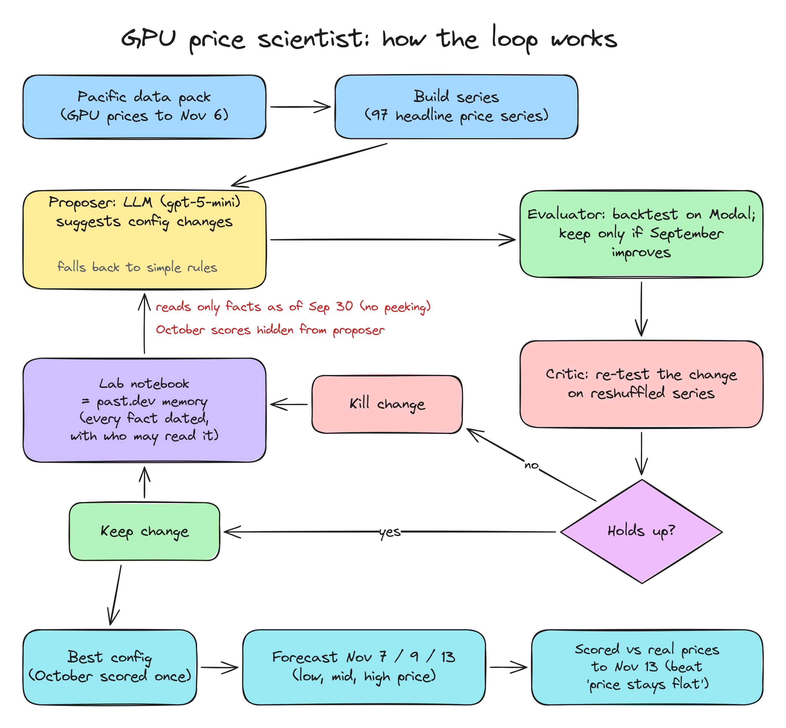

# pacific-hack

Three agents tune a GPU-price forecaster one change at a time. They share an experiment ledger on past.dev and run their backtests on Modal. This folder also builds the Sunday submission for Pacific track 2.



## Results

All picks were made on Jul–Sep origins. October was scored once, after the pick was fixed.

- *Scored set (the 37 series the 11-06 catalog marks headline).* The submission uses the loop's final pick: `half_life_days 14, drift_weight 0.03, pool_weight 0.7, min_samples 6, momentum_fit 0.2`, in `submit_config.json` under `default`. Its October skill is +0.149 vs +0.122 for the starter. Its 10–90 band holds the October truth 71% of the time, against 62% for the starter. The earlier hand pick (`pool_weight 0.5, half_life_days 14, band_scale 1.2`) scored +0.134.
- *AWS spot trend (a finding; no AWS spot series is scored).* Spot prices trend, so a momentum term helps there: October skill +0.36 vs +0.26 for the starter on 80 AWS spot series. The same config scores +0.10 on the 37, below the starter, so the submission uses it for `aws_spot.` series only.
- *Agent loop.* One change did the real work, and the search stalled after round 3. An 8-round run (`scored37-e`: LLM proposer, past.dev memory, Modal) tried 24 one-parameter changes. 7 passed the gate and the critic corroborated all 7, but replaying them one at a time (`results/keeps_scored37e.txt`) shows:
  - *1 real win:* `pool_weight 0.7` in round 3, +0.062 Jul–Sep and +0.039 September.
  - *1 trade:* `half_life_days 14` in round 1 lifted September by 0.019 and left Jul–Sep flat (−0.001), so it gained September by losing July and August.
  - *5 near-zero keeps:* `momentum_fit 0.2`, `drift_weight 0.02` and `0.03`, `min_samples 5` and `6` each moved Jul–Sep and September by less than 0.001. They passed only because the gate keeps any September gain above zero.

  Rounds 4 to 8 found nothing new. They kept retrying the same few params (`min_samples` every round, then `band_scale`, `drift_weight`, `momentum`, `window_days`) and never revisited `pool_weight` or `half_life_days`. Jul–Sep skill went from +0.096 to +0.157, and all of that was in place by round 3.

  On October, scored once at the end, the loop's pick gets +0.149 against the starter's +0.122. A bootstrap over the 37 series (`results/bootstrap_october_37.txt`, 10,000 resamples) puts the difference at +0.027, 95% interval +0.008 to +0.055, above zero in 99.8% of resamples. Against the hand pick it is +0.015 (+0.004 to +0.027, 99.8%). The resamples are of series, over one month, so they say nothing about a different month. The loop's band holds the October truth 71% of the time, against 76% for the hand pick.

  The hand pick came from the Jul–Sep sweep (`results/sweep_julsep_37.txt`) before this run. It widened the band (`band_scale 1.2`): Jul–Sep coverage 0.79 instead of 0.76, for 0.007 less Jul–Sep skill. The loop gates on skill alone, so it ends with narrower bands. We switched the submission from the hand pick to the loop's pick after seeing October, so that choice used October. Chart: `results/loop_rounds.png`. Every idea and every memory read: `results/dashboard.html`.

Skill is the track's: 1 − total pinball loss / total loss of the flat last-value forecast, pooled over every cell. Files:

| File | What |
| --- | --- |
| `results/backtest.json` | starter vs model on the 37 and on AWS spot: Jul–Sep, September and October skill, coverage |
| `results/sweep_julsep_37.txt` | the Jul–Sep sweep the pick came from (no October) |
| `results/october_37_three_models.txt` | October on the 37 for the three candidate configs |
| `results/bootstrap_october_37.txt` | the October gains of the hand pick and the loop's pick (now `submit_config`) over the starter, resampled over series |
| `results/keeps_scored37e.txt` | each change the loop kept, replayed one at a time on Jul–Sep (`scripts/keeps37.py`) |
| `results/history_37.csv` | days of history per scored series |
| `results/loop_rounds.json`, `.png` | the agent loop, round by round |
| `results/spend.md` | Modal and OpenAI spend for the runs above |

## Reproduce

```bash
uv sync --group pack
./reproduce.sh <unzipped gpu-price-pack-v0.1.1-handover dir>
```

This builds the series from the pack, writes `results/backtest.json` and writes `submission_2026-11-06.csv` (origin 11-06, horizons 1/3/7, every series in the build). The CSV covers all 725 series; the scorer ignores ids outside its truth file. The sweep and the October table come from `scripts/sweep37.py` and `scripts/october37.py`.

Challenger (not the submission): `challenger_v81_2026-11-06.csv` is the v8.1 pick 870891d at origin 11-06, same rows and schema (2175 rows, 725 series). Reproduce: `uv run python research/challenger.py research/forecaster_agent_v81.py data/series_scored.npz 2026-11-06 challenger_v81_2026-11-06.csv "v8.1 pick 870891d (research forecaster, code: loop/research/forecaster_agent_v81.py); challenger, not the submission"`. Its holdout result is in `research/v81-record/HOLDOUT.md`.

Challenger v8.3 (not the submission): `challenger_v83_2026-11-06.csv` is the v8.3 pick cfeab06 at origin 11-06, same rows and schema (2175 rows, 725 series). It was picked on dev data to Nov 6 by a rule written before the round, with no unseen weeks left, so its gains are dev-only evidence until November is scored. Reproduce: `uv run python research/challenger.py research/forecaster_agent_v83.py data/series_scored.npz 2026-11-06 challenger_v83_2026-11-06.csv "v8.3 pick cfeab06, dev-only evidence (holdout weeks already used); code: loop/research/forecaster_agent_v83.py; challenger, not the submission"`. The round and pick are in `research/v83-record/`.

Run the loop:

```bash
uv run python -m pacific_hack.run                                  # local JSONL ledger, local runner
set -a; . <your env file with PAST_API_KEY, OPENAI_API_KEY>; set +a
PACIFIC_SERIES=data/series_scored.npz uv run python -m pacific_hack.run \
    --memory past --runner modal --proposer llm --scope my-run -n 8 \
    --trace results/loop_rounds.json
uv run --with matplotlib python scripts/plot_rounds.py results/loop_rounds.json results/loop_rounds.png
uv run python -c "import sys,pytest; sys.exit(pytest.main(['-q','tests']))"   # tests, offline
```

The trace is rewritten after every round. If a run stops early, `scripts/finish_trace.py` scores its last config and fills in the final block.

Flags: `-n` rounds (default 3), `--batch` candidates per round (3), `--seed`, `--ledger` (JSONL path), `--memory jsonl|past`, `--runner local|modal`, `--proposer rule|llm` (default `rule`), `--trace` (round-by-round JSON), `--scope` (past.dev run tag). `PACIFIC_SERIES` picks the series build; `PACIFIC_DATA=synthetic` swaps in fake step-shaped series for offline tests.

## The forecaster

Posted GPU prices move in steps, so on most days tomorrow's price is today's. The middle forecast (q50) is the last price. The low and high (q10, q90) come from past h-day log changes of the series. `ForecasterConfig` (`forecaster.py`) adds recency weights, pooling with series of the same kind of seller, a band scale, drift and AR(1) momentum. All defaults off reproduce the starter's `last_value_empirical` exactly.

Pooling sees all 725 series in the build. Only the 37 scored series count toward skill.

## The loop

Each round, three agents work through one shared ledger (`memory.py`):

1. The *proposer* reads the ledger as of the forecast date (2026-09-30) and writes a batch of one-parameter hypotheses. It skips ideas already tried and ranks params by their kept and killed history.
2. The *evaluator* backtests the batch in one `harness.backtest_batch` call (the Modal fan-out). It keeps a change only if September skill rises and Jul–Sep skill drops by at most 0.005. It writes kept or killed.
3. The *critic* re-scores each kept idea on bootstrap resamples of the scored series, toggling only that idea's param on the current config. It writes refuted or corroborated from the September change. A refuted idea rolls the config back.

October never decides anything. A run reports it once, for the final config.

## past.dev challenge

Demo: `./demo_read.sh` (needs `PAST_API_KEY`). The evaluator writes a public verdict and a private October score. The proposer reads the verdict and gets nothing private. The critic reads both. The script then shows the raw server response. `./demo_read.sh <scope>` reads a finished run's ledger as the proposer. Every run also writes `results/dashboard.html`, which lists every read and write.

### Agents

Each agent reads and writes as its own past.dev identity. Two of them act on facts another agent wrote.

| Agent | Identity | Audiences it reaches | Writes | Reads |
| --- | --- | --- | --- | --- |
| proposer | `pacific-proposer` | none (public only) | hypotheses | as of 2026-09-30: the evaluator's kept/killed and the critic's verdicts. It skips tried ideas and ranks params; the LLM gets them in its prompt. |
| evaluator | `pacific-evaluator` | none | kept/killed with Jul–Sep numbers (public); per-idea October and September deltas (`holdout-scores`); throughput notes | nothing: it gets the batch in code |
| critic | `pacific-critic` | `holdout-scores` | refuted/corroborated (public); its resample numbers (`holdout-scores`) | as of 2026-10-31: the evaluator's kept decisions and private results, to pick what to re-check |

The loop itself writes one public baseline note and the baseline's October score (`holdout-scores`). The evaluator writes into `holdout-scores` but cannot read it back.

### Layers

Memory is split four ways. Each split keeps one agent from using a number it should not see.

- *Public ledger.* Hypotheses, decisions and verdicts, with Jul–Sep numbers and a one-line reason. One data point per idea (`ledger:<scope>:hyp-<idea>`), re-sent as it moves from proposed to kept to refuted, so past.dev supersedes the old claim. Why: the proposer needs the history to avoid repeats and to rank params.
- *Holdout layer.* October numbers live in the fixed audience `holdout-scores`, whose only member is `pacific-critic`. Why: the proposer must never tune on October, and the critic needs it to judge.
- *Time.* Each fact's past.dev `timestamp` is the market date it describes. Reads send `queryTimestamp` = the reader's forecast date. Why: a read as of September 30 cannot see later facts.
- *Run.* `--scope` tags every fact and leads its text; reads keep only that run. Why: an idea judged on another series world is not evidence here.

Enforcement: past.dev applies the audience and the date cut on the server, and the client filters both again (`memory.py`). `tests/test_pastdev_live.py` checks the server side against the live API. Offline tests check the client side, with a server that wrongly returns private and later facts.

Data in past.dev: everything above, one data point per ledger fact. The full entry rides in `metadata.entry`; `content` is an English sentence.

Data in local files:

- the price series (`data/*.npz`, built from the pack; git-ignored)
- the configs (`submit_config.json`) and the submission CSV
- `results/`: backtests, the loop trace with its read/write log, charts, the dashboard, spend
- the LLM prompt (`llm_proposer.py`)
- the ledger itself when run with `--memory jsonl` (`ledger.jsonl`)
- inside one process: the current config, and the ids of ideas the proposer wrote (see Caveats)

API use: `POST /ingest` to write and `GET /ingest/{id}` to wait for it, `POST /recall` to read (with `identity`, `queryTimestamp`, `limit`), and `PUT /audiences/holdout-scores` to set up the private layer.

### Results

Run `scored37-e` used live past.dev end to end, with three identities and scope `scored37-e`. The trace (`results/loop_rounds.json`, `memory_log`) records:

- *Writes:* 110 facts. 78 public: 24 hypotheses, 24 evaluator decisions, 7 critic verdicts, 22 throughput notes, 1 baseline note. 32 private (`holdout-scores`): the evaluator's and critic's October numbers and the baseline's.
- *Reads across agents:* the proposer read the ledger once a round and got 89 evaluator facts and 68 critic facts. It used them to skip tried ideas and to rank params; the LLM saw them in its prompt. It got 0 private facts. The critic read 221 evaluator facts, private ones included, to pick what to re-check.
- *No repeats:* 24 ideas, 24 distinct ids and 24 distinct changes.
- *Server enforcement:* `tests/test_pastdev_live.py` writes a private fact and a later fact, then reads as each agent. It passes against the live API.

The dashboard shows the same counts per agent and layer, plus a line for every read and write.

### Caveats

- *Identity is not a credential.* All three agents share one project key, and the identity is a field in each request. The boundary keeps honest code from seeing October numbers. It does not stop an agent that lies about who it is.
- *Recall cannot list or filter by run.* past.dev has no list route, and recall ranks over the whole project. `entries()` runs four broad recalls and keeps this run's facts. As the project filled with older runs, recall started returning only a few facts from the current one. In run `scored37-d` the proposer saw 2 of 3 ideas, reused an idea id, and overwrote a kept idea's fact; we stopped that run. Fixes: the scope now leads every fact and query, and the proposer keeps the ids it wrote in this process, so ids stay unique. It also logs how many of its ideas the ledger shows each round. In `scored37-e` the proposer's read returned every idea so far in 7 of 8 rounds. In round 8 it missed 1 of 21 (`idea-020`, kept one round earlier); the ids it kept in memory stopped a repeat.
- *Only October is private.* Public facts are visible to every identity in the project, including other runs' agents. Per-agent private notes do not exist.
- *A re-send without an audience makes a fact public* (a past.dev rule). Private results use their own ids and are never re-sent public; nothing tests this beyond code review.
- *We read back our own records, not past.dev's extracted memories.* Readers rebuild entries from `metadata.entry`. past.dev's claim extraction runs, but the loop does not depend on it.
- *No memory ablation.* We did not run the loop without memory, so we have no number for how much memory adds.
- *Network failures.* The VM's DNS and Modal connection dropped several times. Run `scored37-a` died in round 3, `scored37-b` after round 6 (its final score came from `scripts/finish_trace.py`), and `scored37-c` before round 1; `scored37-d` was stopped for the bug above. Their facts stay in the project under their scopes. Calls now retry for about 3 minutes.
- *Small scale.* A run writes tens of facts. Nothing here tests past.dev at volume.

## LLM proposer (`--proposer llm`)

`llm_proposer.py` sends OpenAI (Chat Completions, strict JSON schema output) the current config, a field schema and the public ledger history: decisions, verdicts, reasons and Jul–Sep numbers. October entries are hidden by the read boundary and filtered out of the prompt again. It returns up to `--batch` single-field changes, each with a one-line hypothesis. Unknown fields, out-of-range values, no-ops, ideas already in the ledger and a second change to one param are dropped. If the key is missing, the call fails or nothing valid comes back, the rule-based proposer runs instead.

Env: `OPENAI_API_KEY`, `PROPOSER_MODEL` (default `gpt-5-mini`).

## Modal

The evaluator's batch (current config plus every candidate) and the critic's resample checks go through `harness.backtest_batch(configs, runner, seed)`. With `--runner modal`, `modal_app.run_batch` maps `backtest_remote.starmap(jobs)` over containers, one job per (config, seed). The series build rides in the image. `harness.session` keeps one app open for the whole loop. Each batch writes a throughput note (`runner`, `steps`, `seconds`, `steps_per_hour`), where a step is one forecast date walked for one config. The Modal SDK reads its own token; the code never touches credentials.

With warm containers a batch runs about 100,000 steps per hour; a cold start manages about 7,500. Each loop run cost under a cent of Modal time; `results/spend.md` has the bill.

## Self-healing (research harness)

When the final pick loses to the incumbent on the holdout, `research/harness/heal.py` runs the repair round itself. From the holdout it gets three numbers: the skill difference and its 95% interval. Everything else it hands on is dev data. A fresh director agent, in a sandbox that holds only this packet, sees per-cell dev results for the incumbent, the pick and the pick's parent, every chain step with its commit message, and how often prices moved by period. It writes a post-mortem line for LESSONS.md and proposes checks as code.

heal.py then tests each check without network. A check must reject the pick, pass the incumbent and reject at most half of the chain's earlier keeps. Checks that fail or crash are dropped and logged. The rest go to `harness/healed/round_N.py`, which `guards.py` adds to the keep rule and the pick rule. A check can only reject more, so the locked keep rule never loosens. Last, heal.py logs a meta round ("healing round N, trigger = holdout fail"), extends dev to the last holdout target, and restarts the researchers from the pick's parent and the incumbent. If the pick won, it logs "no heal needed" and stops. The manifest it rehashes is run.py's (`HARNESS_MANIFEST`, else `research/harness.sha256`), and the lesson goes to the shared LESSONS.md under `SHARED_DIR`. Researchers start through the script in `RESEARCHER_SANDBOX`; if that is unset, heal.py prepares the worktrees and prints the launch commands.

History: a human started the v8.1 healing round on 2026-11-15, after the v8 pick b06b208 lost to v7 on October (−0.080). From this commit the trigger is in the loop. `heal.py --dry-run` replays that round and prints the restart instead of running it; `tests/test_heal.py` covers the trigger and the trial on a fake case. In the replay (`research/heal/round_6-dry/`), the fresh director found the pick's uncapped trend extension and proposed three checks: medians moved outside the incumbent's band, damage on one line, and skill in the last 15 dev days. All three reject b06b208, pass v7 and reject none of the earlier keeps. They match what the human round wrote as G1–G3. The director call cost $0.78.

## Limits

- 20 of the 37 scored series have only 23 days of Jul–Sep history (`results/history_37.csv`), so their bands rest on pooled changes from similar series.
- Ideas in one batch are each scored against the pre-batch config, then kept changes apply together. Params differ within a batch, so interactions are small but real.
- *Next step for the loop (not run).* The gate keeps any September gain above zero, so 5 of 7 keeps in `scored37-e` were noise-sized, and the proposer kept spending rounds on params with nothing left. Two small fixes: keep a change only if September gains a set minimum (for example 0.002; the round-3 win was 0.039), and tell the proposer which params had two near-zero or killed tries in a row so it moves to others. Either should take a few lines in `agents.py` and one 8-round run to check.
- The 10–90 band covers 76% on October, short of the nominal 80%. A wider band (1.3) reached 0.80 on Jul–Sep but cost 0.021 skill there, so the pick stops at 1.2.
